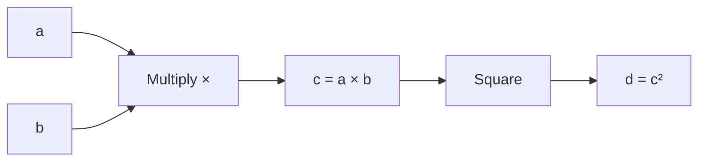
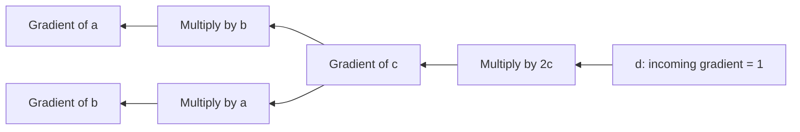

<p align="center">
  
</p>

<h1 align="center">LearnDeep</h1>

<p align="center">
  A Deep Learning Framework Built From Scratch in C++
</p>

# 04 Deep Learning From Scratch: Autograd

## Autograd 101

The term *autograd* stands for automatic gradient computation. In deep learning frameworks, it commonly refers to a system that automatically calculates gradients of a computation with respect to its inputs and parameters.

Consider a simple function:

$y=x^2+3x$

If we want to calculate how \(y\) changes with respect to \(x\), we differentiate the function:

$\frac{dy}{dx}=2x+3$

We could derive this derivative manually. But what happens when the function consists of hundreds of tensor operations across multiple layers?

We don't want to manually derive and implement the derivative of every possible model. We need a mechanism that systematically applies the chain rule to the operations we execute.

That is the motivation for automatic differentiation.

An important distinction: autodiff is not symbolic differentiation, and it is not numerical differentiation using finite differences. It computes derivatives by applying derivative rules to the operations in the computation.

## Forward Propagation versus Backward Propagation

Let's use a small example that will help us understand the process.

$a=2,\quad b=3$

$c=a+b,\quad d=c^2$

The forward pass calculates:

$c=5,\quad d=25$

Now suppose we want the derivatives of \(d\) with respect to \(a\) and \(b\).

Using the chain rule,

$\frac{\partial d}{\partial c}=2c=10$

Since \(c=a+b\),

$
\frac{\partial c}{\partial a}=1,\qquad
\frac{\partial c}{\partial b}=1
$

Therefore,

$
\frac{\partial d}{\partial a}=10,\qquad
\frac{\partial d}{\partial b}=10
$

We can see that the forward pass calculates the values, while the backward pass calculates how those values influence the final output.

## Why Reverse-Mode Autodiff?

There are two commonly used modes of automatic differentiation:

1. **Forward mode:** propagates derivatives alongside the forward computation.
2. **Reverse mode:** calculates the forward values first, then propagates gradients backward from the output.

Reverse mode is particularly useful when a function has many inputs but a relatively small number of outputs. Neural networks commonly have millions of parameters and a scalar loss, which makes reverse mode a natural choice.

Now we can take advantage of our graph-mode execution. Since we have already recorded our operations, we can traverse their dependencies backward and construct a backward graph corresponding to the forward computation.

## So, How Do I Do This?

My implementation follows three main steps:

1. **Recording dependencies:** Each operation establishes relationships between its input and output tensors within the computational graph.
2. **Propagating gradients:** Starting from the output, the framework visits operations in reverse dependency order and applies each operation's derivative rule.
3. **Accumulating gradients:** When a tensor contributes to multiple downstream operations, the gradient contributions are added together.

Let's see how this works in actual code.

For each operation, I have an `addGradGraph()` subroutine that takes `Graph* graph` as its argument. Its responsibility is to register the backward operations for that particular operation in the gradient graph.

For example, consider the multiplication operation:

```cpp
void Mul::addGradGraph(Graph* graph) {

    /*
       getGradients() retrieves the incoming gradient
       tensors associated with this operation's output.

       If multiple downstream paths contribute gradients,
       we need to accumulate those contributions.
    */
    std::vector<tf::tensor> incoming_gradients =
        graph->getGradients(this);

    // Accumulate the incoming gradients.
    for each incoming_gradient {
        // Perform an accumulative sum.
        store(accumulated_gradients);
    }

    /*
       Now that we have accumulated the incoming gradients,
       we can calculate the partial derivatives for
       each input of the multiplication operation.
    */
    for each input {

        // For multiplication:
        // f(x[i]) = x[i] * x_b
        // df/dx[i] = x_b

        // Register the backward multiplication operation.
        Ops ops_mul = new Opsmul();

        graph->addGradientNode(accumulated_gradients);
        graph->addGradientNode(other_input);
        graph->addGradientNode(ops_mul);

        graph->addEdge(accumulated_gradients, ops_mul);
        graph->addEdge(other_input, ops_mul);

        tf::tensor output;
        graph->addGradientNode(output);
        graph->addEdge(ops_mul, output);

        output_going_gradient.push_back(output);
    }
}
```

*Note: The snippet above is simplified pseudocode to illustrate the implementation. The actual C++ syntax and ownership details depend on the implementation.*

This is how I register a backward computation for each operation in the autodiff graph. At the end, I store the resulting tensor nodes representing the gradients for the corresponding input tensors.

For multiplication, each input has its own derivative path. The gradient for one input is multiplied by the other input, following the chain rule.

### Let's Visualize It

Consider the following sequence of operations:

$c=a* b$


$d=c^2$

#### Forward graph

The forward graph represents the sequence of operations used to calculate the output.



The graph starts with the input tensors `a` and `b`. The multiplication operation produces `c`, which is then squared to produce `d`.

#### Backward graph

The backward graph represents the derivative operations required to calculate the gradients.

We start by seeding the output gradient:

The backward pass starts by seeding the output gradient:

$
\bar{d} = \frac{\partial d}{\partial d} = 1
$

For the square operation:

$
\bar{c} = \bar{d} \times 2c
$

For the multiplication operation:

$
\bar{a} = \bar{c} \times b
$

$
\bar{b} = \bar{c} \times a
$

Here, the bar notation represents the gradient propagated to each tensor.



Notice that the backward graph does not simply repeat the forward operations in reverse order. It contains the derivative operations required by the chain rule.

The forward graph calculates values, while the backward graph calculates gradients.

### Triggering Automatic Differentiation

Now let's see how the API brings everything together.

```cpp
{
    tf::graph_context ctx;

    // Forward operations are recorded here.
    // ...

    ctx.initialize_gradient(); // Construct the gradient graph
    ctx.compute_gradient();    // Execute the gradient graph

    tf::tensor input_a_grad =
        ctx.get_gradient(input_a); // Retrieve the input gradient
}
```

The process works as follows:

1. The autodiff API is triggered within a graph context.
2. The graph context retrieves the active graph session.
3. The graph calls `createGradientGraph()`, which traverses the operation nodes using DFS and registers the backward computation for each operation.
4. The gradient graph is executed, and the resulting gradients can be retrieved for the corresponding tensors.

With this mechanism in place, my framework can automatically propagate gradients through the supported operations in its computational graph.

Voilà! This is what an autodiff engine is supposed to do, isn't it?

[Add Supporting Screenshots: Forward Graph, Backward Graph, `addGradGraph()` Implementation, and Gradient Test Results]

**To be continued...**